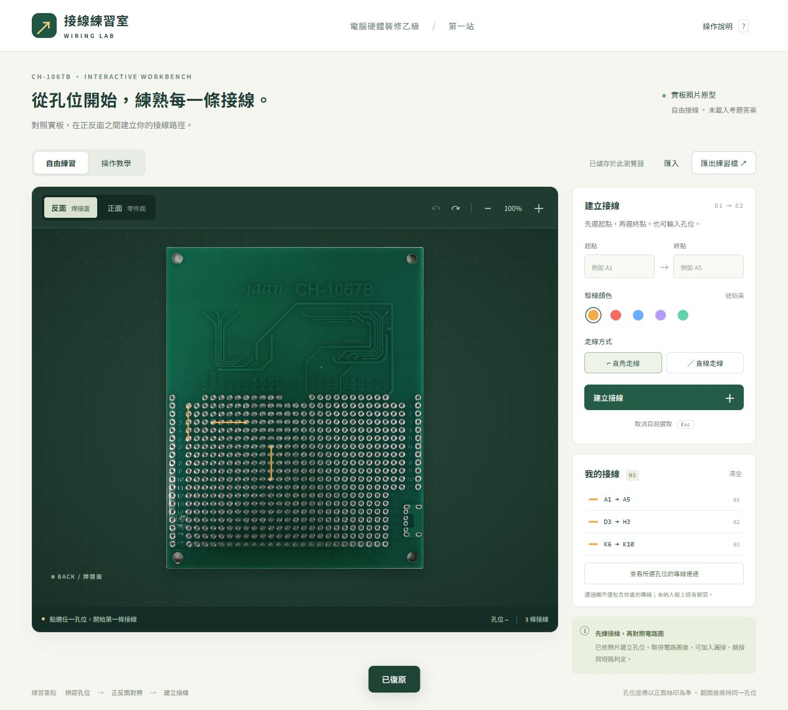

# CH-1067B 接線練習室

電腦硬體裝修乙級第一站的互動接線練習原型，使用 CH-1067B 電路板正反面實拍照片。

[開啟接線練習網站（GitHub Pages）](https://tom8787.github.io/ch1067b-wiring-lab/)



## 功能

- 531 個可點選接點，涵蓋矩陣孔、旁邊 20 個接點、邊緣 31 個排針孔、22 個延伸孔，以及 USB 區的 8 個焊孔。
- 邊緣孔位以正面文字朝向命名：上緣 1～18、下緣 1～11，兩排另各有一個「外側」接點；正反面使用相同編號。
- USB 接點以 A～D 作練習用編號，不代表正式腳位功能；固定焊孔另標示為「USB 固定孔 1～4」。延伸孔使用「延伸排 1-1～1-11」及「延伸排 2-1～2-11」。
- 正面、反面均以文字正向顯示，同一孔位與導線可在兩面對照。
- 銀色圓點標示 42 個原有零件位置：H11～U11、H8～U8，以及 W15、W16、S16、T16、N13、N15、L17、L15、J17、J15、L13、J13、W13、W10。標記處仍可接線。
- 點選起點與終點建立導線，也能直接輸入孔位座標。
- 五種導線顏色、直線或直角走線、板面縮放。
- 選取導線後拖曳實心轉折點調整路徑，拖曳空心點新增轉折；雙擊實心點刪除，方向鍵微調（Shift 加大步幅）。每條導線最多 32 個轉折點，支援正反面對照、自動儲存、匯入匯出、復原與重做，亦可重設路徑。
- 刪除、復原、重做，以及瀏覽器自動儲存。
- JSON 練習檔匯入與匯出。
- 操作教學與使用者所畫導線的連通顯示。

## 直接使用離線版

下載儲存庫後，以瀏覽器開啟 **offline.html**。照片、樣式、程式與孔位資料已包含在單一檔案內，不需啟動伺服器。

## 開發與執行

需要可執行 ECMAScript 模組的 Node.js，無需安裝第三方套件。

```sh
node serve.mjs
```

在瀏覽器開啟 http://localhost:4317 。修改原始碼後重新整理網頁。

執行核心檢查：

```sh
node check.mjs
```

修改模組後重新產生離線版：

```sh
node build-offline.mjs
```

## 檔案

| 檔案 | 用途 |
| --- | --- |
| index.html、style.css | 網站結構與樣式 |
| app.mjs | 板面渲染、操作及存檔 |
| core.mjs | 照片座標轉換、導線連通及匯入驗證 |
| holes.json | 孔位座標及正反面對應 |
| board-front.jpg、board-back.jpg | 原始電路板照片 |
| offline.html | 可直接開啟的完整離線版 |
| serve.mjs | 僅監聽本機的靜態伺服器 |
| check.mjs | 核心檢查 |
| build-offline.mjs | 離線版產生工具 |

## 目前範圍

這是自由接線原型，目前未載入正式考題電路圖或答案，不提供考試評分。操作教學的接線為滑鼠操作示範，並非考題答案。

連通顯示僅計算使用者畫出的導線，尚未納入電路板既有銅箔。USB 固定孔供位置練習，不推定其電氣連通關係。照片孔位仍需實板核對；表面黏著焊盤尚未開放接線。
